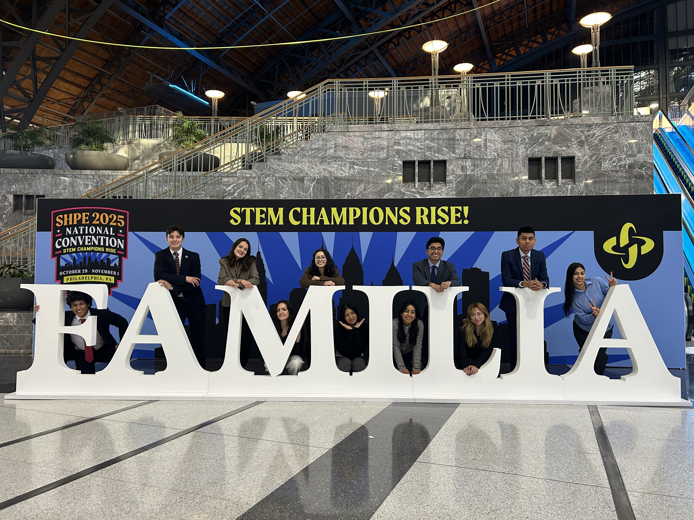
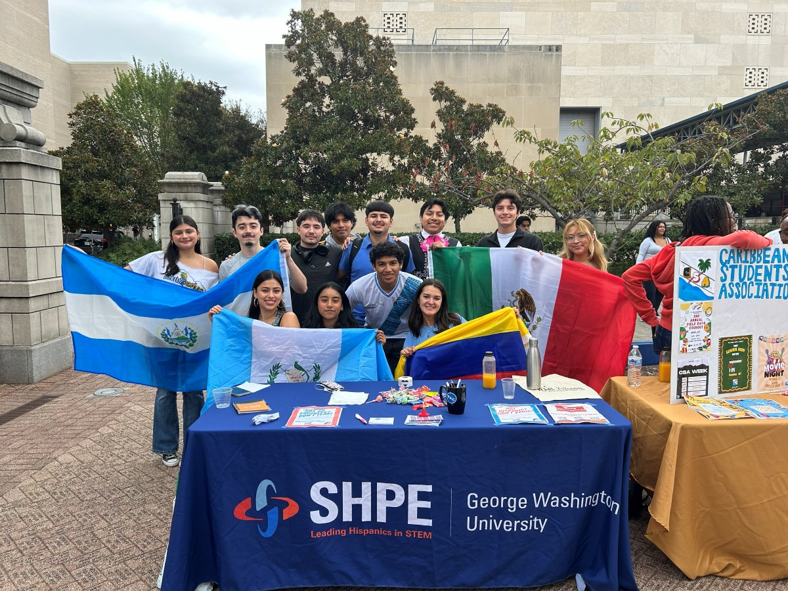
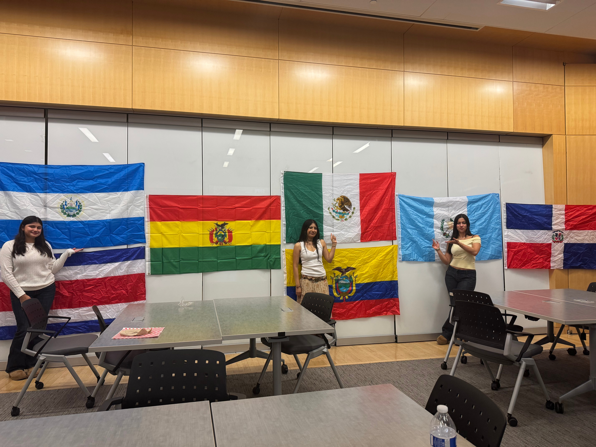

::: {.hero .column-screen}

{.hero-bg fig-alt="SHPE GW members"}
[[Welcome to the [Society of Hispanic Professional Engineers]{style="color:#72A9BE;"} at the [George Washington University]{style="color:#D6BF91;"}]{.hero-highlight}]{.hero-title}
:::

::: {.after-hero .column-screen}
::: {.after-hero-inner}
::: {.about-heading}
## About Us
:::

::: {.about-card}
{fig-alt="convention 2025"}

::: {.about-card-text}
### [SHPE]{style="color:#001F5B;"}

The Society of Hispanic Professional Engineers (SHPE) is a national organization dedicated to empowering the Hispanic community and other underrepresented groups in STEM. Through a network of student and professional chapters, SHPE provides opportunities for leadership development, mentorship, networking, and career advancement. By promoting academic excellence and professional growth, SHPE strives to increase representation in STEM and create a lasting impact on future generations.

:::
:::

::: {.about-card}
{fig-alt="Picnic"}

::: {.about-card-text}
### [SHPE at GW]{style="color:#D6BF91;"}

SHPE GWU, revived in 2020, is dedicated to empowering Hispanic students and other underrepresented communities through STEM awareness, professional development, and academic support. Our chapter fosters a strong Latinx familia at GW by creating opportunities for community building, career advancement, and meaningful connections within the engineering field. Through partnerships and sponsorships, we aim to expand our impact and continue supporting the next generation of diverse STEM leaders.

:::
:::

::: {.about-card}
{fig-alt="Meet La Familia"}

::: {.about-card-text}
### [Our Mission]{style="color:#FD652F;"}

SHPE changes lives by empowering the Hispanic community to drive social and economic growth by excelling in STEM.

:::
:::

::: {.about-card}
{fig-alt="Team02"}

::: {.about-card-text}
### [Our Vision]{style="color:#FD652F;"}

SHPE’s vision is a world where Hispanics are highly valued and influential as the leading innovators, scientists, mathematicians, and engineers.

:::
:::

:::

::: {.join-links-social}
[<i class="bi bi-instagram"></i> Instagram](https://www.instagram.com/shpe_gwu){.btn .join-btn}

[<i class="bi bi-linkedin"></i> LinkedIn](https://www.linkedin.com/company/shpegwu){.btn .join-btn}

[<i class="bi bi-link-45deg"></i> Linktree](https://linktr.ee/shpegwu){.btn .join-btn}
:::

:::
